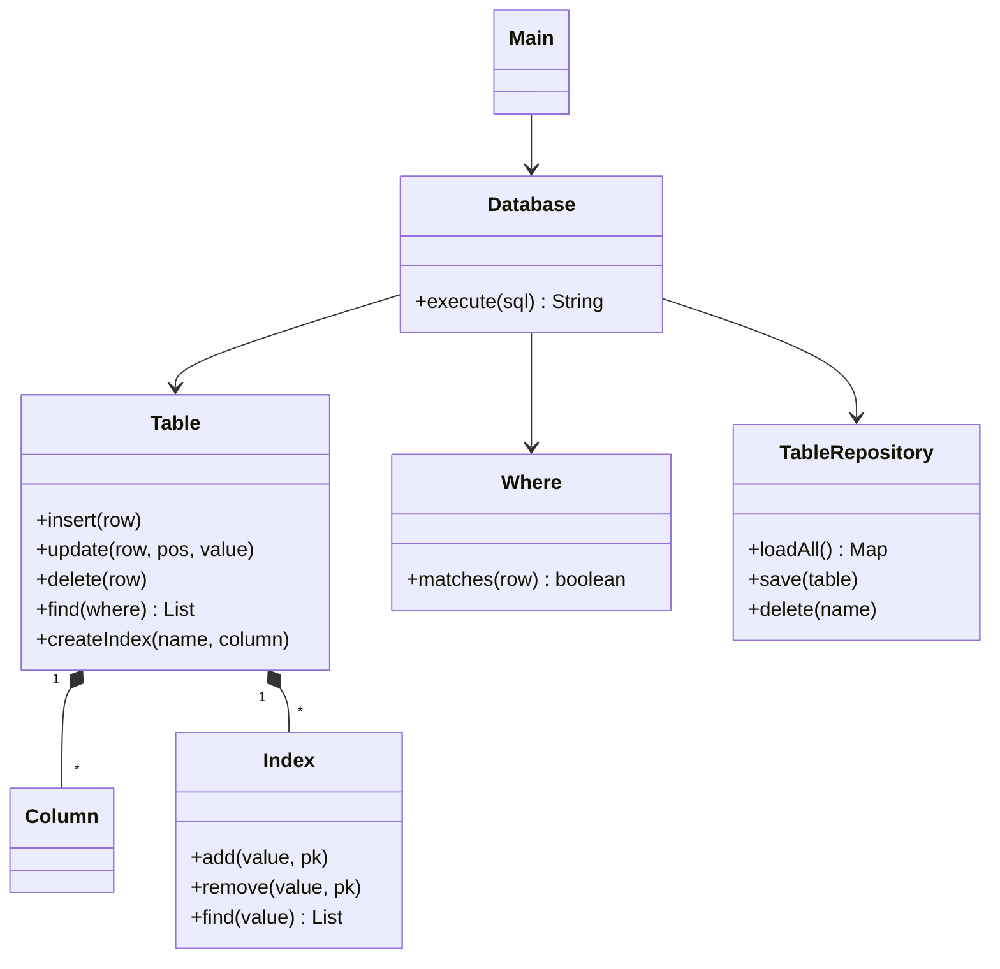
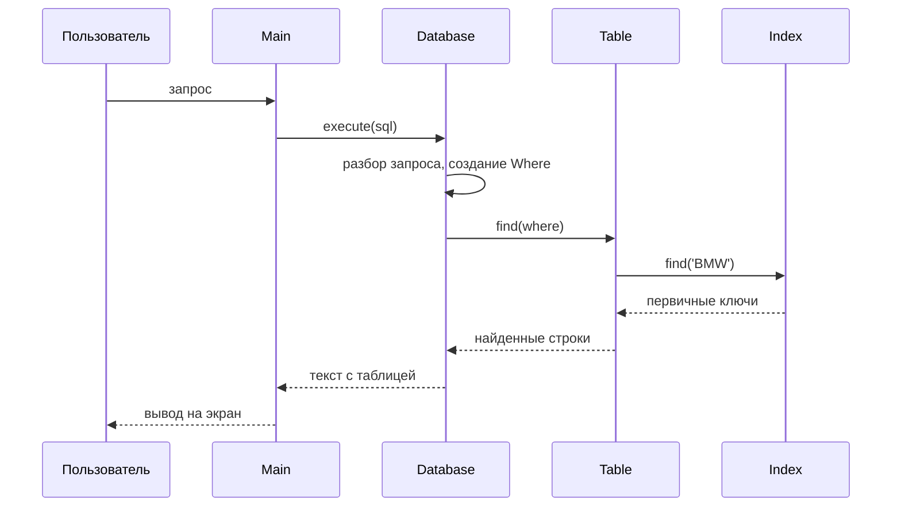

# 2-я л/р, выполнила Агранович Марианна, 25КНТ-2
# MiniDB — упрощённая СУБД на Java

Учебная СУБД: таблицы со связью по ключу, SQL-подобные запросы, хранение в файлах, индексы.

## Что умеет

- Типы данных: `INT`, `DOUBLE`, `STRING`, `DATE` (`'ГГГГ-ММ-ДД'`), `BOOLEAN`.
- Запросы: `CREATE TABLE`, `DROP TABLE`, `CREATE INDEX`, `INSERT` (одна или несколько строк), `SELECT`, `UPDATE`, `DELETE`.
- `WHERE`: операции `= != <> < <= > >=`, условия соединяются через `AND` и `OR`.
- Первичный ключ (проверка уникальности) и внешний ключ (`REFERENCES таблица`).
- Индекс по столбцу: сохраняется на диск вместе с таблицей, при запуске загружается, ускоряет `SELECT`, `UPDATE` и `DELETE` с условием `столбец = значение`.

## Инструкция пользователя

Сборка и запуск:

```
javac Main.java
java Main
```

Данные хранятся в папке `data` (другую папку можно указать аргументом: `java Main mydata`).
Запрос заканчивается символом `;`, его можно писать в несколько строк. Команды `help`, `tables` (список таблиц) и `exit`.
Пример сценария: `java Main < demo.sql`.

Примеры запросов:


Ограничения: у таблицы один первичный ключ, его нельзя менять через `UPDATE`; нельзя удалить строку, на которую ссылаются из другой таблицы, и таблицу, на которую есть ссылки; строки в запросах пишутся в одинарных кавычках без кавычек внутри; скобки в `WHERE` не поддерживаются.

## Архитектура

Весь код находится в одном файле `Main.java`, классы в нём идут по порядку из таблицы ниже.

| Класс | Назначение |
|---|---|
| `Main` | консольный интерфейс |
| `Database` | разбор и выполнение запросов, проверка внешних ключей |
| `Table` | столбцы, строки, индексы, поиск строк |
| `Column` | описание столбца |
| `Index` | индекс (значение -> первичные ключи) |
| `Where` | условие `WHERE` |
| `TableRepository` | чтение и запись файлов на диске (паттерн DAO) |
| `DbException` | ошибка запроса |
| `Benchmark` | сравнение скорости с индексом и без |

### Диаграмма классов



### Диаграмма последовательности: `SELECT * FROM cars WHERE brand = 'BMW'`



### Хранение на диске

Каждая таблица вместе со своими индексами сохраняется в файл `<имя>.tbl` с помощью стандартной сериализации Java.
После каждого изменяющего запроса файл записывается заново: сначала во временный файл `.tmp`, затем он переименовывается в `.tbl`.
Если программа аварийно завершилась во время записи, старый файл остаётся целым, а лишний `.tmp` удаляется при следующем запуске.
`INSERT` с несколькими строками выполняется целиком: при ошибке уже добавленные строки удаляются.

## Тестирование производительности

Запуск: `java Benchmark` (после `javac Main.java`). Таблица `cars(id, brand, price)`, на каждую марку приходится примерно 10 строк.
Выполняется 200 запросов вида `SELECT * FROM cars WHERE brand = '...'`, в таблице указано суммарное время. Результаты с индексом и без него сравниваются между собой и совпадают.

| Строк | Без индекса, мс | С индексом, мс | Ускорение |
|---:|---:|---:|---:|
| 10 000 | 270 | 37 | ×7 |
| 50 000 | 518 | 19 | ×27 |
| 100 000 | 526 | 10 | ×52 |

Без индекса запрос просматривает всю таблицу, поэтому время растёт с её размером. С индексом ищутся только нужные строки, и время почти не зависит от размера таблицы. Точные цифры зависят от компьютера и от прогрева JVM (на 10 000 строк это заметнее всего), поэтому при проверке лучше запустить тест у себя.

## Выводы

Реализована СУБД с таблицами, связанными по ключу, SQL-подобным языком запросов, хранением на диске и индексами.
Тест показал, что индекс заметно ускоряет поиск по значению, а на 100 тысячах строк выигрыш составил более чем в 50 раз.
Недостатки: вся таблица записывается на диск при каждом изменении, индекс работает только для условия «равно», нет транзакций и `JOIN`.

## Список использованных источников

1. Хабр. Статья об индексировании баз данных (как индексы ускоряют поиск). https://habr.com/ru/post/724066
2. Хабр. Статья о том, как устроены индексы в PostgreSQL (перевод). https://habr.com/en/articles/308752
3. Хабр. Статья о сериализации объектов в Java (Serializable, ObjectOutputStream). https://habr.com/ru/articles/431524/

## Список использованных источников

1. Хабр, статья об индексировании https://habr.com/ru/post/724066
2. Хабр, статья об индексах в PostgreSQL https://habr.com/en/articles/308752
3. Хабр, статья о сериализации объектов https://habr.com/ru/articles/431524/
